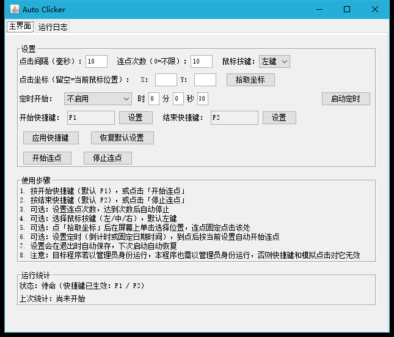

# Auto Clicker

基于 Java 17 的 Windows 桌面连点工具，支持全局快捷键，可打包为内嵌 JRE 的绿色独立版。

## 界面预览



## 功能

- 设置鼠标左键/中键/右键点击间隔（毫秒）
- 自定义开始 / 结束全局快捷键（默认 F1 / F2）
- 设置连点次数，达到次数后自动停止（0 = 不限）
- 设置固定点击坐标：点「拾取坐标」后在屏幕上单击选择位置，连点固定点击该处（留空则点击当前鼠标位置）
- 定时开始连点：支持倒计时（时/分/秒分开输入）或固定日期时间（`yyyy-MM-dd HH:mm:ss`），到点按当前设置自动点击
- 按开始快捷键：开始连点，窗口最小化到任务栏
- 按结束快捷键：停止连点，恢复窗口并显示点击次数与持续时间（秒）
- 也可使用界面上的「开始连点」「停止连点」按钮，以及「恢复默认设置」
- 设置自动保存：退出（及应用/拾取坐标/恢复默认）时写入程序目录 `auto-clicker-settings.properties`，下次启动自动恢复

## 常见问题

- **在其他程序里快捷键或模拟点击无效**：若目标程序以管理员身份运行，本程序也必须以管理员身份运行（Windows UIPI 限制，静默失效无报错）。右键 exe 选「以管理员身份运行」。
- **固定坐标点击位置偏移**：启动日志会输出光标实际落点与目标坐标的比对，若不一致通常是显示缩放或多显示器导致。
- 若勾选了连点次数，达到次数后会自动停止并恢复窗口。

## 用户使用（独立版）

1. 复制 `target` 目录下的 `auto-clicker.exe`、`auto-clicker.jar` 和 `runtime` 文件夹到任意位置（保持同级）
2. 双击 **`auto-clicker.exe`**（若无反应则用 **`launch.bat`**）
3. 无需安装 Java，无需安装程序，绿色便携运行

### 使用步骤

1. 按开始快捷键（默认 **F1**），或点击「开始连点」
2. 按结束快捷键（默认 **F2**），或点击「停止连点」

### 日志

- 程序界面「运行日志」tab 页查看运行日志
- 同时写入程序目录下的 `auto-clicker.log`

## 开发者打包

### 环境要求

- Windows 10/11
- **JDK 17+**（需包含 `jpackage`、`jlink`，仅打包时需要）
- Maven 3.6+

### 一键打包独立版（内嵌 JRE）

在项目目录运行：

```bat
一键打包.bat
```

脚本会先用 Maven 构建并生成 exe，再用 `jlink` + `jpackage` 生成内嵌 JRE 的独立应用。

若提示找不到 Java，请先安装 [Temurin JDK 17+](https://adoptium.net/) 并设置 `JAVA_HOME`。

打包失败时查看项目根目录的 **`build.log`**。

### 打包产物

执行 `mvn clean package` 或 `一键打包.bat` 后，产物位于 `target` 目录：

| 路径 | 说明 |
|------|------|
| `target/auto-clicker.exe` | 主程序（双击运行，需与 jar、runtime 同级） |
| `target/auto-clicker.jar` | 程序 jar（与 exe 同目录） |
| `target/runtime/` | 内嵌 JRE（勿删除） |
| `target/launch.bat` | 备用启动脚本（直接调用内嵌 JRE） |
| `target/auto-clicker.zip` | 可选：打包 exe + jar + runtime 便于分发 |

将 **`auto-clicker.exe`**、**`auto-clicker.jar`** 和 **`runtime`** 文件夹放在同一目录即可使用。

若 exe 双击无反应，请双击 **`target/launch.bat`** 或 **`双击运行.bat`** 启动。

### 开发调试（无需 jpackage）

```bat
mvn clean package
java -jar target\auto-clicker.jar
```

需本机已安装 JRE 17+。

## 注意事项

- 仅支持 Windows（全局快捷键依赖 Win32 API）
- 首次运行若安全软件提示键盘钩子权限，请选择允许
- 修改快捷键后需点击「应用快捷键」
- 开始与结束快捷键不能相同
- 程序正常退出时会自动卸载键盘钩子
